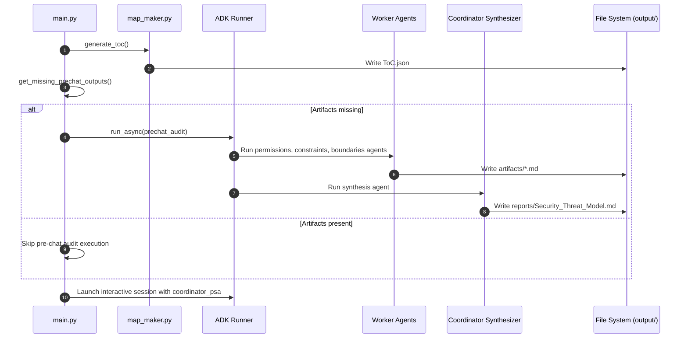

# Architecture & Data Flow Guide

## 1. Executive Summary

The **Security Documentation Analysis Agent (SDAA)** is an autonomous multi-agent system built on the **Google Agent Development Kit (ADK)**. Its primary mission is to perform automated, deep architectural security audits of technical documentation corpora, identifying permissions issues, negative constraints, and security boundary violations, and synthesizing them into a comprehensive **Security Threat Model**.

---

## 2. System Architecture & Topology

SDAA adopts a **Supervisor-Worker (Hierarchical Coordinator)** topology backed by a multi-stage execution pipeline.

```mermaid
graph TD
    User([User / CLI]) --> Main[main.py Entrypoint]
    
    subgraph Phase 1: Map Maker
        Main --> MapMaker[map_maker.py]
        MapMaker --> DocsDir[(Docs Corpus)]
        MapMaker --> ToC[ToC.json]
    end

    subgraph Phase 2.5: Pre-Chat Audit (SequentialAgent)
        Main --> PreChat[SequentialAgent: prechat_audit]
        PreChat --> Worker1[permissions_agent]
        PreChat --> Worker2[constraints_agent]
        PreChat --> Worker3[boundaries_agent]
        PreChat --> Synth[coordinator_synth]
        
        Worker1 --> Art1[artifacts/permissions_agent.md]
        Worker2 --> Art2[artifacts/constraints_agent.md]
        Worker3 --> Art3[artifacts/boundaries_agent.md]
        Synth --> FinalReport[reports/Security_Threat_Model.md]
    end

    subgraph Phase 3: Interactive Chat Session
        Main --> Coord[coordinator_psa]
        User <-->|Interactive Query| Coord
        Coord --> ReadToC[read_file / ToC.json]
        Coord --> ReadArts[read_file / artifacts]
    end
```

---

## 3. Execution Pipeline Phases

### Phase 1: Map Maker (`sdaa/src/core/map_maker.py`)
- **Objective**: Asynchronously index the target documentation corpus (`docs_root`).
- **Operation**:
  1. Traverses all Markdown files within `docs_root`.
  2. For each file, calls a lightweight LLM (`gemini-2.0-flash-001` or `gemma-3-27b-it`).
  3. Extracts a **one-sentence architectural summary** and **exactly three keyword tags**.
  4. Writes the structured index to `system.output_dir/ToC.json`.
- **Skip Logic**: Can be bypassed via `--skip-map-maker` or automatically when `ToC.json` is detected.

---

### Phase 2.5: Pre-Chat Audit (`build_prechat_audit_agent`)
- **Objective**: Execute automated worker analysis sequentially prior to opening the interactive session.
- **Topology**: `google.adk.agents.SequentialAgent` combining four agents in order:
  1. `permissions_agent`: Analyzes roles, access controls, and permission matrices.
  2. `constraints_agent`: Analyzes negative security constraints and invariance rules.
  3. `boundaries_agent`: Analyzes security perimeter boundaries and trust zones.
  4. `coordinator_synth`: Compiles individual worker artifacts into `Security_Threat_Model.md`.
- **Optimization Guard (`ArtifactLoaderModel`)**: If an artifact file (e.g., `permissions_agent.md`) already exists on disk, `build_prechat_audit_agent` swaps out the LLM for `ArtifactLoaderModel`, simulating tool invocation without invoking remote LLM APIs.

---

### Phase 3: Interactive Chat Loop
- **Objective**: Provide an interactive security Q&A environment powered by `coordinator_psa`.
- **Interface**: Uses `RichUI` (`sdaa/src/ui/rich_chat.py`) for streaming formatted terminal output.
- **Capabilities**: The coordinator maintains session memory (`InMemorySessionService`, `InMemoryMemoryService`) and can inspect documentation or pre-computed audit reports on demand.

---

## 4. Component Inventory & Responsibility Matrix

| Component | Path | Responsibility |
| :--- | :--- | :--- |
| **CLI / Entrypoint** | `main.py` | Command-line parsing, instrumentation setup, phase orchestration, session management. |
| **Config Loader** | `sdaa/src/core/config_loader.py` | Parses `config.yaml`, resolves output directory paths, manages system settings. |
| **Model Factory** | `sdaa/src/core/model_factory.py` | Instantiates appropriate model wrapper (`Gemini`, `OpenRouterModel`, `InstrumentedGemini`) per agent & provider. |
| **Prompt Manager** | `sdaa/src/utils/prompt_manager.py` | Dynamic prompt fetching from Langfuse with fallback mechanisms and OTEL span linking. |
| **Map Maker** | `sdaa/src/core/map_maker.py` | Synchronous file scanner & ToC generator. |
| **Worker Agents** | `sdaa/src/agents/workers.py` | Defines `permissions_agent`, `constraints_agent`, and `boundaries_agent`. |
| **Coordinator** | `sdaa/src/agents/coordinator.py` | Defines main supervisor agent (`coordinator_psa`) and report synthesizer (`coordinator_synth`). |
| **File Tools** | `sdaa/src/tools/file_ops.py` | Safe file system read/list utilities preventing path traversal outside `docs_root` / `output_dir`. |
| **Reporting Tools** | `sdaa/src/tools/reporting.py` | Functions to write markdown reports (`permissions_agent.md`, `Security_Threat_Model.md`, etc.). |
| **Rich UI** | `sdaa/src/ui/rich_chat.py` | Terminal interface for live streaming, status indicators, and user interactions. |

---

## 5. End-to-End Data Flow Sequence


