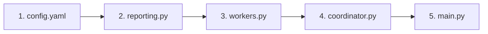

# Extending SDAA & Adding New Agents

## 1. Executive Summary

This guide provides a step-by-step developer tutorial for extending the **Security Documentation Analysis Agent (SDAA)** system. It walks through adding a new specialized worker agent (for example, a `compliance_agent` or `vulnerabilities_agent`) to the pipeline, wiring its reporting tools, linking dynamic prompts, and integrating it into both the pre-chat audit and supervisor coordinator.

---

## 2. End-to-End Workflow Overview

To add a new worker agent named `compliance_agent`, you need to modify 5 key areas:



1. **`sdaa/config/config.yaml`**: Define per-provider model mappings and prompt metadata.
2. **`sdaa/src/tools/reporting.py`**: Create a tool function to persist the agent's findings to `artifacts/`.
3. **`sdaa/src/agents/workers.py`**: Implement the factory function to instantiate the `LlmAgent`.
4. **`sdaa/src/agents/coordinator.py`**: Register the agent with `coordinator_psa` and add its output key to `create_coordinator_synthesizer`.
5. **`main.py`**: Add the agent to `_expected_prechat_output_paths()` and `build_prechat_audit_agent()`.

---

## 3. Step-by-Step Implementation Guide

### Step 1: Update Configuration (`sdaa/config/config.yaml`)

Add an entry for your new agent under `agents` in `config.yaml`. Specify the model to use for each provider (`openrouter`, `gemini`) and the Langfuse prompt slug/label.

```yaml
agents:
  # ... existing agents ...

  compliance_agent:
    openrouter: "x-ai/grok-4.1-fast"
    gemini: "gemini-2.5-flash"
    prompt:
      name: "compliance-agent"
      label: "production"
```

---

### Step 2: Create the Reporting Tool (`sdaa/src/tools/reporting.py`)

Define a tool function that the agent will invoke to record its analysis and save markdown findings to `output/artifacts/`.

```python
def report_compliance_analysis(findings: str) -> str:
    """
    Logs compliance audit findings (e.g., SOC2, GDPR, HIPAA) and saves to artifact file.

    Args:
        findings: Markdown description of compliance audit findings.
    Returns:
        Status message string.
    """
    try:
        artifacts_dir = config_loader.get_artifacts_dir()
        filepath = os.path.join(artifacts_dir, "compliance_agent.md")
        with open(filepath, "w", encoding="utf-8") as f:
            f.write(findings)
        return f"Compliance findings recorded and saved to {filepath}."
    except Exception as e:
        return f"Error saving compliance findings: {str(e)}"
```

---

### Step 3: Implement Agent Factory (`sdaa/src/agents/workers.py`)

Create a factory function `create_compliance_agent` that fetches the dynamic system prompt, applies template sanitization, and returns an ADK `LlmAgent`.

```python
from sdaa.src.tools.reporting import report_compliance_analysis

def create_compliance_agent(model=None):
    if model is None:
        model = MockModel(model="mock-model")

    agent_config = config_loader.get("agents.compliance_agent", {})
    prompt_config = agent_config.get("prompt", {})

    prompt_obj = prompt_manager.get_prompt_object(
        name=prompt_config.get("name", "compliance-agent"),
        label=prompt_config.get("label", "production")
    )
    
    prompt = ""
    if prompt_obj:
        try:
            prompt = prompt_obj.compile()
            if hasattr(model, "set_langfuse_prompt"):
                model.set_langfuse_prompt(prompt_obj)
        except Exception:
            pass

    if not prompt:
        prompt = "Error: Could not fetch 'compliance-agent' prompt from Langfuse."

    # Sanitize identifier braces to prevent ADK context template crashes
    prompt = re.sub(r"\{([a-zA-Z_]\w*)\}", r"(\1)", prompt)

    return LlmAgent(
        name="compliance_agent",
        instruction=prompt,
        model=model,
        tools=[read_file, list_files, report_compliance_analysis],
        output_key="compliance_report"
    )
```

---

### Step 4: Register with Coordinator (`sdaa/src/agents/coordinator.py`)

1. **Add to `create_coordinator_agent`**:
   Instantiate the agent's model and pass the agent into `sub_agents`:

   ```python
   comp_model = get_model_for_agent("compliance_agent", provider)
   compliance_agent = create_compliance_agent(model=comp_model)

   return LlmAgent(
       name="coordinator_psa",
       instruction=prompt,
       model=model,
       tools=[read_file, generate_final_report],
       sub_agents=[permissions_agent, constraints_agent, boundaries_agent, compliance_agent]
   )
   ```

2. **Add to `create_coordinator_synthesizer`**:
   Extract `compliance_report` from session state inside `_build_synthesis_prompt`:

   ```python
   compliance_report = re.sub(
       r"\{([a-zA-Z_]\w*)\}", 
       r"(\1)", 
       (ctx.state.get("compliance_report") or "").strip()
   ) or "MISSING: compliance_report"

   # Pass to synthesizer prompt compilation
   prompt = prompt_obj.compile(
       permissions_report=permissions_report,
       constraints_report=constraints_report,
       boundaries_report=boundaries_report,
       compliance_report=compliance_report
   )
   ```

---

### Step 5: Update Main CLI Runner (`main.py`)

1. **Update `_expected_prechat_output_paths()`**:
   ```python
   def _expected_prechat_output_paths() -> list[str]:
       artifacts_dir = config_loader.get_artifacts_dir()
       reports_dir = config_loader.get_reports_dir()
       return [
           os.path.join(artifacts_dir, "permissions_agent.md"),
           os.path.join(artifacts_dir, "constraints_agent.md"),
           os.path.join(artifacts_dir, "boundaries_agent.md"),
           os.path.join(artifacts_dir, "compliance_agent.md"), # Added
           os.path.join(reports_dir, "Security_Threat_Model.md"),
       ]
   ```

2. **Update `build_prechat_audit_agent()`**:
   ```python
   comp_model = get_worker_model(
       "compliance_agent", "compliance_agent.md", "report_compliance_analysis", "findings"
   )
   compliance_agent = create_compliance_agent(model=comp_model)

   return SequentialAgent(
       name="prechat_audit",
       sub_agents=[
           permissions_agent,
           constraints_agent,
           boundaries_agent,
           compliance_agent,
           coordinator_synth
       ]
   )
   ```

---

## 4. Testing & Verification

1. **Verify with Mock Model**:
   Execute the pre-chat audit using the mock provider to confirm agent creation and tool binding without spending API credits:
   ```bash
   python main.py -m mock
   ```

2. **Verify Artifact Generation**:
   Confirm that running `python main.py -m gemini` writes the new `compliance_agent.md` file to `output/artifacts/`.
