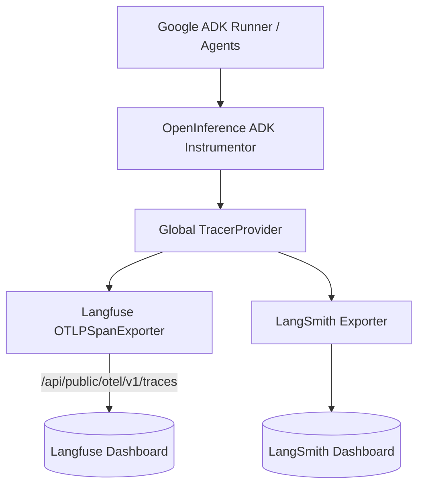

# Observability & Prompt Management Guide

## 1. Executive Summary

This guide details the **Observability & Telemetry Infrastructure** and **Externalized Prompt Management** implemented within the Security Documentation Analysis Agent (SDAA). SDAA uses unified **OpenTelemetry (OTEL)** tracing supporting both **Langfuse** and **LangSmith** concurrently, alongside dynamic prompt versioning via Langfuse.

---

## 2. OpenTelemetry Tracing Infrastructure

### Architecture Diagram



### 2.1 Unified Instrumentation (`sdaa/src/core/instrumentation.py`)
Both Langfuse and LangSmith telemetry exporters attach to a single `TracerProvider` during application startup via `setup_instrumentation()`:
The Langfuse SDK owns exactly one export processor; prompt retrieval reuses that client rather than adding another exporter. Standalone prompt access disables tracing. An explicit export-all filter retains custom adapter and application parent spans.

1. **Auto-Instrumentation**: Uses `openinference-instrumentation-google-adk` to automatically trace ADK `Runner`, `LlmAgent`, tool invocations, and model calls.
2. **Langfuse OTLP Endpoint**:
   - Defaults to `${LANGFUSE_HOST}/api/public/otel/v1/traces`.
   - Supports overriding via `LANGFUSE_OTEL_TRACES_ENDPOINT`.
   - Performs Basic Auth using `${LANGFUSE_PUBLIC_KEY}:${LANGFUSE_SECRET_KEY}`.
3. **Health Check Guard**:
   - Before attaching the `OTLPSpanExporter`, `setup_instrumentation()` sends an HTTP GET request to `${LANGFUSE_HOST}/api/public/health`.
   - If the backend is unreachable or returns an HTTP error, Langfuse tracing is gracefully disabled, preventing network timeouts or noisy stack traces during normal CLI execution.
   - The exporter sends the `x-langfuse-ingestion-version: 4` header, which Langfuse Cloud requires after its v4 cutover.
4. **OpenRouter Usage and Cost**:
   - For OpenRouter calls, the `OpenRouterModel.generate_content` span carries OpenRouter's token usage (`langfuse.observation.usage_details`) and USD cost (`langfuse.observation.cost_details`), and is the only span that does.
5. **One Session per Run**:
   - `--run-id <id>` sets both the ADK session ID and Langfuse `session.id`. If omitted, the CLI generates `YYYYMMDDTHHMMSSZ-<6 hex>` in UTC, including for interactive runs.
   - The `docsdiver.run` root wraps Map Maker and the audit/chat. SDK `propagate_attributes()` establishes session, user, tags and trace name before child calls. The tagging processor also preserves process-level `LANGFUSE_TRACING_ENVIRONMENT` and `LANGFUSE_RELEASE` on custom-provider spans.
   - The root stores request configuration and the completed security report (or failure status). In ToC-only mode its output identifies that mode. Root report contents follow the same data-handling policy as existing worker/model spans.
   - The SDK flushes after the root ends, including exceptional exits. Exports remain buffered, best-effort OTLP with exporter retries; a successful flush is not proof of backend ingestion. No shutdown occurs between runs in the same process.
   - The existing LangSmith tag branch is unchanged; its implicit-context check can also tag child spans.
   - The processor is installed only when an exporter is configured. For a Langfuse-only run, verify the log contains `Langfuse observability initialized`; a failed health check prevents installation.

### 2.2 Headless Run Manifest

- Headless runs write `run_manifest.json` in the output directory on success, exit 1 and uncaught exceptions. Usage errors and interactive runs write no manifest.
- The manifest records run ID, timestamps, arguments, effective paths, code state, the start-of-run corpus hash, per-agent models and prompts, the call ledger, output hashes and outcome.
- Output statuses come from the regeneration set, not file timestamps. Replayed worker artifacts remain `reused` even though their reporting tools rewrite them.
- `usage.cost_usd` is the cross-check for Langfuse cost: compare it with the sum of costs over distinct `OpenRouterModel.generate_content` observation IDs, not ADK wrapper spans.
- Calls without usage/cost and streaming calls count as unmetered; their tokens and cost contribute zero to aggregate usage.
- OpenRouter and mock calls are recorded. `InstrumentedGemini` calls are not recorded in P3; a zero-call Gemini manifest is not evidence of a fully metered audit.
- Prompt name/version come from the object used by each call. Map Maker's inline prompt has null name/version. The synthesizer clears its previous prompt before every fetch, so a failed fetch cannot retain a stale version.
- The `provider` field may be null for OpenRouter responses. No routing-metadata request is added in P3.

### 2.3 Langfuse v4 platform rollout
The declared Python SDK range is `>=5.2.0,<6`; `requirements.lock` resolves 5.2.0. Platform v4 is not SDK major v4: the current supported SDK major is v5. Python 3.11+ and Langfuse Cloud or self-hosted v4.59.0+ are required; self-hosted v3 is blocked until the server is upgraded.

Repository inspection found no evaluator definitions, dataset experiment runners, deprecated Langfuse read API consumers or export configurations. This does not establish project state. With a confirmed target host/project, inspect active and inactive evaluator rules and the Evaluators UI for Legacy rows; preserve disabled rules for rollback. `docsdiver.run` is only a **candidate target** for an overall-audit observation evaluator, not a project-verified contract. Inputs and report are colocated; add any other required evaluator variables to this observation only after inspecting actual mappings.

Before production cutover, send a non-production canary with a root, generation and tool child. Inspect hierarchy, root I/O, every child's session and filtering attributes, generation usage/cost/prompt links, unique observation IDs, and session cost including cost-bearing children. Confirm server compatibility, evaluator matching/scores/logs and Observations API v2 fields. No project access was used for the repository migration.

Inspect Project Settings > Integrations for Blob Storage, Mixpanel and PostHog exports. Validate enriched-observation consumers in dual-source mode and get downstream-owner approval before enriched-only. Preserve credentials, schedules, prefixes and formats. Do not enable evaluator successors without approval; retain disabled legacy rules and existing export settings for rollback.

---

## 3. Dynamic Prompt Management with Langfuse

System prompts are externalized to **Langfuse Prompt Management**, enabling real-time prompt updates and version control without redeploying code.

### 3.1 Prompt Fetching (`sdaa/src/utils/prompt_manager.py`)
The `PromptManager` singleton handles retrieval of prompt definitions:

```python
from sdaa.src.utils.prompt_manager import prompt_manager

# Fetch prompt object by slug name and release label
prompt_obj = prompt_manager.get_prompt_object(
    name="permissions-agent",
    label="production"
)

# Compile text output
prompt_text = prompt_obj.compile()
```

### 3.2 Prompts Registry Reference

| Agent | Langfuse Prompt Name | Default Label | Fallback Behavior |
| :--- | :--- | :--- | :--- |
| **Coordinator Supervisor** | `coordinator-agent` | `production` | Returns error message if fetch fails. |
| **Coordinator Synthesizer** | `report-synthesizer` | `production` | Compiles with `permissions_report`, `constraints_report`, `boundaries_report`. |
| **Permissions Agent** | `permissions-agent` | `production` | Analyzes roles and access matrices. |
| **Constraints Agent** | `negative-constraints-agent` | `production` | Analyzes negative invariants and logic rules. |
| **Boundaries Agent** | `security-boundaries-agent` | `production` | Analyzes perimeter boundaries and trust zones. |

---

### 3.3 Prompt Linking & Telemetry Metadata
To attribute LLM generations directly to specific prompt versions in Langfuse traces:
1. `PromptManager.get_prompt_object()` returns the raw Langfuse `TextPromptClient` object.
2. Models (`InstrumentedGemini` and `OpenRouterModel`) accept this object via `.set_langfuse_prompt(prompt_obj)`.
3. During content generation, metadata (prompt ID, version, name) is attached to the active OpenTelemetry span.

---

### 3.4 ADK Template Engine Sanitization

> [!IMPORTANT]
> Google ADK automatically attempts to substitute curly brace sequences `{variable}` as context template parameters. If a prompt fetched from Langfuse contains raw JSON examples, code snippets, or identifiers like `{user_id}`, ADK throws `KeyError: Context variable not found: user_id`.

To prevent crashes while allowing prompts to contain illustrative code samples, SDAA applies a regex sanitization pass to all fetched prompts before passing them to `LlmAgent`:

```python
# Translates single-line identifier braces: {user_id} -> (user_id)
prompt = re.sub(r"\{([a-zA-Z_]\w*)\}", r"(\1)", prompt)
```

---

## 4. Logging & SDK Warning Suppression

When models execute tool calls during streaming, the `google-genai` SDK emits noisy log warnings regarding non-text response parts (`.text` accessed on function call responses).

In `main.py`, `suppress_genai_non_text_warning()` attaches a custom `logging.Filter` to `google_genai.types`:

```python
class _SuppressNonTextWarning(logging.Filter):
    def filter(self, record: logging.LogRecord) -> bool:
        return "non-text parts in the response" not in record.getMessage()

logging.getLogger("google_genai.types").addFilter(_SuppressNonTextWarning())
```

---

## 5. Connectivity Validation & Troubleshooting

Diagnostic scripts in `scripts/` allow validating telemetry connections independently:

### 1. Validate Gemini & OpenRouter APIs
```bash
python scripts/validate_connections.py
```
Checks API key validity and network reachability for LLM providers.

### 2. Validate Langfuse Connectivity & OTEL Tracing
```bash
python scripts/validate_langfuse_conn.py
```
Pings the Langfuse health check endpoint (`/api/public/health`) and sends a test OTEL span to verify delivery.

### 3. Validate LangSmith Tracing
```bash
python scripts/test_langsmith_tracing.py
```
Emits a test trace to LangSmith to confirm project and API key configuration.
